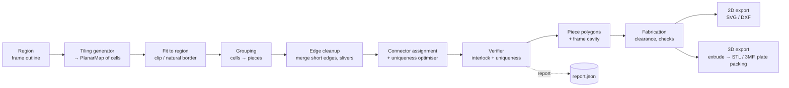

# puzzlegen — Design Document

Status: draft v0.1 (design only, no code yet) · Date: 2026-11-01

A modular Python tool that generates **irregular interlocking puzzles** from planar
tilings (Voronoi, Penrose, the "hat"/Spectre monotiles, and others). It outputs
**STL/3MF** for FDM printing and **SVG/DXF** for laser or vinyl cutters. An optional
**frame** has borders that match the puzzle. The goal is a puzzle with **exactly one
valid assembly**.

---

## 1. Goals and non-goals

### Goals
| # | Goal | Measurable criterion |
|---|------|----------------------|
| G1 | Several tiling sources behind one interface | Adding a tiling = one new module, no core changes |
| G2 | Pieces interlock in the plane | Every piece is held by at least one undercut (neck) joint, or is bounded by the frame |
| G3 | Unique solution | The verifier proves that each interior edge has exactly one compatible partner (Section 7) |
| G4 | Printable or cuttable | Minimum neck width, feature size and clearance pass checks, and the STL is manifold |
| G5 | Optional frame with matching border | The frame cavity equals the union of the pieces plus clearance |
| G6 | Reproducible | Same config + seed gives byte-identical output; every run writes a JSON report |
| G7 | Controllable granularity | Target piece count N (±10 %) or target piece size |

### Non-goals (for v1)
- True 3D puzzles (burr or volumetric interlocking). The tool makes 2.5D pieces: 2D
  outlines extruded to a thickness.
- Image printing on pieces. A later hook for multi-colour top layers is planned (Section 10.5).
- A GUI. The tool is CLI + config file; it writes an SVG preview.

---

## 2. Core idea: a pipeline over a planar map

The key design decision is to keep **topology (shared edges) as the primary data
structure, not individual polygons**. Each interior edge between two pieces exists
once, is decorated once (with its connector curve) and is consumed by both neighbours
in opposite directions. This guarantees gap-free, overlap-free pieces by construction.
Clearance is applied only at the very end, as a fabrication step.



Every stage is a pure function `PlanarMap → PlanarMap` (or `→ Pieces`) with explicit
parameters and an explicit `numpy.random.Generator`. This makes stages
unit-testable, swappable and reproducible.

### 2.1 Central data structure: `PlanarMap` (half-edge / DCEL)

```
Vertex   : id, pos (x, y)
HalfEdge : id, origin → Vertex, twin, next, prev, face, curve_id
Face     : id, outer half-edge, kind ∈ {cell, piece, outside, frame}, tags
Curve    : id, polyline (vertex→vertex in canonical direction), connector spec, edge_class
```

- A **cell** is a tile from the generator. A **piece** is a face after grouping (one
  or more cells merged). Grouping removes internal edges and keeps a
  `piece → [cells]` mapping for reporting.
- A `Curve` belongs to one *undirected* edge. Each half-edge reads it forwards or
  backwards. Connector decoration replaces the straight segment with a polyline, and
  both faces change consistently.
- Vertex deduplication: generators that produce floating-point coordinates build the
  map through a snapping hash (round to 1e-7 mm). Substitution tilings can instead use
  exact coordinates (Section 4.3).
- Implementation: plain Python dataclasses with numpy arrays for positions.
  Shapely 2 is used for geometry operations (clipping, buffering, validity) but **not**
  as the source of truth for adjacency.

Why not polygons only? With independent polygons, shared edges drift apart after
decoration or offsetting, gaps and slivers appear, and adjacency has to be
reconstructed with tolerance. That is fragile, so polygons are avoided as the primary
store.

---

## 3. Region and frame (input shape)

A `Region` is a Shapely polygon: a rectangle, circle, regular polygon, an SVG path
(heart, silhouette), or a polygon with holes.

There are two **border modes**:

| Mode | How it works | Frame cavity | Pros / cons |
|------|--------------|--------------|-------------|
| `clip` | Generate the tiling larger than the region and clip it to the region | Smooth region outline (+ clearance) | Classic look. Clipping creates slivers, which Section 6 merges away. Outer edges are straight, so give them connectors so the frame is not "free" |
| `natural` | Keep whole cells whose centroid lies inside the region. The outline becomes the jagged union of cells | Jagged outline (+ clearance) | The frame border *matches* the irregular pieces. Strongly constrains edge pieces and aids uniqueness. Outer outline is only approximately the region shape |
| `natural+clip` | Natural inside, then clip to a slightly larger outer rectangle | Mixed | Gives a rectangular frame exterior with an irregular cavity |

**Frame** (optional, `frame.enabled`):
- `frame.style = tray` (base plate + wall) | `ring` (wall only) | `none`.
- Cavity = `union(pieces).buffer(+clearance)`. Exterior = region bounding shape plus
  wall width, with outer corners rounded.
- Frame edges can carry **connectors toward edge pieces** (`frame.connectors = true`).
  The frame then participates in interlocking and uniqueness like a fixed piece. This
  is what "matching borders" means in the strong sense.
- Large frames are split into segments that fit the print bed, joined by dovetails
  (`frame.max_segment`).
- Optional thumb notch or a lifted corner so the first piece can be removed.

---

## 4. Tiling generators (plugins)

Interface:

```python
class TilingGenerator(Protocol):
    name: str
    def generate(self, region: Region, target_count: int,
                 rng: np.random.Generator, **params) -> PlanarMap: ...
```

Generators register via a simple registry dict (no plugin framework). Each generator
must return a map that covers `region.buffer(margin)`.

### 4.1 Voronoi (first implementation, simplest and most flexible)
- **Seeds**: Poisson-disk (Bridson) for even piece sizes, or uniform random for a
  chaotic look. Density can be modulated by a grey-scale image or a function, so
  piece size varies across the puzzle (a difficulty gradient).
- **Lloyd relaxation**, 0–k iterations: a regularity knob that runs from chaotic to
  honeycomb-like.
- **Power (weighted) diagram**: optional, for controlled size variance.
- Library: `scipy.spatial.Voronoi` on seeds plus mirrored ghost seeds, then clipped
  to the region. Code from orchid-pot's `potlib.py` (Poisson sampling) can be reused.
- Voronoi cells are convex, so they **never interlock by shape alone** and connectors
  are required (Section 5). Degree-3 vertices are typical, which is good for
  connector placement.

### 4.2 Penrose (P2 kite/dart, P3 rhombus) via Robinson-triangle substitution
- Start from a seed configuration (a "sun" of 10 triangles, or one large triangle
  that covers the region) and apply **deflation** k times. Each step scales tiles down
  by φ (golden ratio). In P3, an obtuse triangle splits into 2 obtuse + 1 acute, and
  an acute one into 1 obtuse + 1 acute.
- Merge mirror triangle pairs into rhombi (P3) or kites/darts (P2) after the last step.
- **Granularity**: choose k so the tile count inside the region is about N. Tile
  count grows about φ² per step, so steps are coarse. For finer control, combine with
  grouping (Section 6) or scale the seed.
- **Hierarchical option (as suggested)**: deflate to level `k_fine` but form pieces
  from the *supertiles* at level `k_piece < k_fine`. That is, a piece is the union of
  the fine tiles descended from one coarse tile. The piece outline is then a jagged
  staircase of fine-tile edges. This is still a valid tiling and gives natural
  interlock (Section 6.2). The substitution tree gives this grouping for free: each
  fine tile stores its ancestor id at each level.
- Rhombi have only two shapes and parallel opposite edges, so without connectors the
  puzzle would be massively non-unique. Penrose matching rules (edge arrows or arcs)
  are *local* constraints and do not give global uniqueness. Connectors or
  hierarchical grouping are mandatory here.

### 4.3 Hat and Spectre (aperiodic monotiles)
- **Hat**: a 13-gon (or a 14-gon with two collinear edges) made of 8 kites of the
  [3.4.6.4] Laves tiling, from Smith, Myers, Kaplan and Goodman-Strauss (2023). It
  belongs to the continuum `Tile(a,b)`: hat = Tile(1, √3), turtle = Tile(√3, 1).
  Tile(0,1) (chevron) and Tile(1,0) (comet) tile periodically. Hat tilings contain
  **reflected** hats.
- **Spectre**: Tile(1,1) with modified (curved) edges. It is *strictly chiral*: it
  tiles aperiodically with no reflected copies, even when reflections are allowed.
  This matters for printing: **all Spectre pieces have the same handedness**, so a
  single-sided print never needs mirrored pieces.
- **Generation**: hierarchical substitution over the four **metatiles H, T, P, F**
  (clusters of 4, 1, 2, 2 hats). Implement the substitution from the paper and keep
  track of each hat's ancestry. For the Spectre, use its own substitution (the Spectre
  paper describes clusters).
- **Exact coordinates**: hat vertices lie on the kite lattice. Represent them as
  integer coordinates in a hexagonal or Eisenstein-type basis and convert to mm only at
  the end. This makes vertex deduplication exact. (Spectre vertices are not on that
  lattice, so they use floats with the snapping hash.)
- **Tile(a,b) as a design knob**: interpolate between the hat and the turtle for
  different looks. Edge combinatorics stay the same, so the topology code is unchanged.
- **Puzzle-specific remarks**:
  - Hats are non-convex. Two hats can already partially hook into each other, but
    this does **not** form a secure neck lock. Connectors or hierarchical grouping are
    still needed.
  - In a `hat-flip` mode, use the reflected hats as a deliberate challenge: pieces
    have no top/bottom marking, and some pieces must be flipped. In the default mode,
    print the reflected hats mirrored and mark the top surface.
  - Grouping metatiles (H/T/P/F) or higher-level supertiles into single pieces gives
    very irregular, interlocking outlines (Section 6.2).
- **Reference implementations** (for cross-checking, not copying unless the licence
  allows): Craig Kaplan's interactive hat/spectre web apps. Check the licences before
  porting any code.

### 4.4 Additional cheap generators (later)
- Jittered square or hex grids: the classic jigsaw baseline, useful for tests.
- Archimedean or Laves tilings, plus random edge flips.
- Imported SVG/DXF line art (user-drawn cells) → `PlanarMap` via polygonize.
- Centroidal Voronoi on an image (stippling-like): piece density follows image
  contrast.

---

## 5. Connectors (edge decorations)

A connector is a parametric curve that replaces the straight chord between an edge's
two endpoints. It is defined in a **normalised edge frame**: x along the chord from 0
to 1, y normal to it, scaled by the chord length L.

```python
@dataclass(frozen=True)
class ConnectorSpec:
    kind: str          # "tab", "dovetail", "tee", "wave", "none", ...
    side: int          # +1 bulges into the left face, -1 into the right face
    t: float           # position along the edge (0.3..0.7)
    size: float        # head size relative to min(L, local face depth)
    params: tuple      # kind-specific shape parameters (neck ratio, skew, asymmetry...)
```

### 5.1 Connector library
| Kind | Shape | Locking | Notes |
|------|-------|---------|-------|
| `tab` | Classic jigsaw knob: Bézier neck plus round head | Yes (neck < head) | Default. Parametrised by neck width, head radius, skew, asymmetry and wobble |
| `dovetail` | Trapezoid | Yes | Good for laser-cut wood; also used for frame segments |
| `tee` / `hook` | T or L shapes | Yes | High uniqueness entropy |
| `wave` | Sine or spline wiggle with no neck | **No** | Decoration only. Pair with locking edges |
| `double` | Two small tabs, opposite sides | Yes, strong | For long edges |
| `none` | Straight | No | Short edges, or frame edges if desired |

### 5.2 Geometric feasibility (per edge)
- A connector's swept region must stay inside the **feasibility zone** of the edge:
  the intersection of both adjacent faces, shrunk by `min_wall`, and kept away from
  the edge's end vertices by `end_margin`. Compute this zone with Shapely (a lens
  shape built from the two faces). The head size is clipped to it.
- Connectors on edges that share a face must not collide. Check pairwise intersection
  of their swept regions per face. On conflict: reduce size, shift `t`, or flip `side`.
- **Short edges** (L < `min_edge_for_connector`, about 2.5 × head diameter) cannot
  carry a lock. Edge cleanup (Section 6.3) should eliminate them. Any that remain are
  flagged in the report.

### 5.3 Fabrication constraints that drive connector sizing (FDM, 0.4 mm nozzle)
| Parameter | Default | Rationale |
|-----------|---------|-----------|
| `clearance` (total gap) | 0.20–0.30 mm | Typical FDM fit; tune with a test-coupon command |
| `min_neck` | ≥ 3 mm (≥ 7 lines of 0.4 mm after offset) | Necks break first |
| `min_feature` | ≥ 1.2 mm | Three perimeters |
| `min_radius` (concave) | ≥ clearance + 0.4 mm | The nozzle cannot reproduce sharp inner corners |
| `thickness` | 3–5 mm | Stiffness vs print time |
| Laser `kerf` | 0.1–0.2 mm (material dependent) | Here clearance = kerf; edges are cut once (Section 9.1) |

These defaults are engineering starting points, not measured values. Section 11 adds a
calibration coupon generator to measure them per printer and material.

---

## 6. Grouping and cleanup (granularity and interlock from tiling structure)

### 6.1 Why grouping
- The tiling granularity is not always the piece granularity. Substitution tilings
  jump in coarse steps, and N is rarely hit exactly.
- Grouping is the main source of **shape irregularity**. It is also the only way to
  get *shape-based* interlock from convex or polygonal tilings.

### 6.2 Grouping strategies
| Strategy | Description | Best with |
|----------|-------------|-----------|
| `identity` | 1 cell = 1 piece | Voronoi, Penrose and hat with connectors |
| `hierarchy` | Piece = all level-0 tiles under one supertile at level k | Penrose and hat/Spectre. Gives fractal-like jagged outlines |
| `grow` | Seeded region growing on the cell adjacency graph to a target size, with compactness and anti-convexity scoring | Any. Fine cells → polyform-like pieces |
| `metatile` | Hat-specific: H/T/P/F clusters as pieces | Hat |

Interlock from grouping: a grouped outline has re-entrant pockets. A pocket "locks"
if a neighbour's protrusion has a neck narrower than its head, measured along the
removal direction. The verifier (Section 7.3) checks this generally, so grouping
needs no special lock logic. Connectors are then optional, per edge class, for
example only on edges that are still straight and long after grouping.

### 6.3 Edge cleanup
1. **Merge collinear runs**: consecutive edges between the same two pieces with an
   angle change < ε become one curve. This matters after hierarchical grouping, where
   a piece boundary consists of many tiny tile edges. Each piece pair should share one
   logical "joint" made of 1..m maximal edge chains.
2. **Short edge collapse**: edges shorter than `min_edge` are contracted to a vertex
   (classic Voronoi cleanup), or the adjacent cells are merged.
3. **Sliver removal** (clip mode): pieces with area < `min_area_ratio` × median area,
   or with an inscribed-circle radius below `min_feature`, are merged into the
   neighbour with the longest shared edge.
4. **Degree-4+ vertices** (Penrose, grids): optionally perturb slightly to split into
   degree-3 vertices. Degree-4 corners are weak and look like "classic jigsaw".

---

## 7. Uniqueness (the core quality property)

### 7.1 Definitions
- An **assembly** places each piece (rotation ∈ SO(2), plus a reflection if pieces
  are flippable) inside the frame cavity with no overlap and full coverage.
- **Unique** means that exactly one assembly exists, up to nothing (the frame fixes
  the global pose). Without a frame, it is unique up to a global rigid motion.

### 7.2 Sufficient construction rule: edge-signature uniqueness
Exact-cover uniqueness for arbitrary shapes is NP-hard in general, so use a
**constructive sufficient condition** that can be checked cheaply:

> **Rule U1 (full joints):** every interior joint carries at least one *locking*
> connector. A connector head can only be received by a matching socket, and sockets
> exist only on joints. Therefore, in any valid assembly, joints mate fully with
> joints. A joint cannot partially overlap two others, because a head would hit a
> solid wall.
>
> **Rule U2 (distinct signatures):** for every joint e, the set of joints e′ whose
> signature (geometry under rotation and, if flippable, reflection) is compatible with
> e within tolerance τ is exactly {twin(e)}.
>
> **Rule U3 (frame):** the frame cavity, plus its connectors, is part of the
> signature set. Boundary joints are therefore also unique.

U1 + U2 + U3 ⇒ every piece's neighbour along every joint is forced ⇒ the adjacency
graph and all poses are forced ⇒ **unique assembly**. The argument relies on every
joint being lockable (U1), which is why Section 6.3 removes short edges.

Tolerance τ: two signatures count as "compatible" if their distance is below
`τ = k · clearance` (k ≈ 3). With a 0.25 mm clearance, connectors that differ by less
than about 0.75 mm in any shape feature are treated as interchangeable. This is
conservative: a real person *will* force a near-fit.

### 7.3 Signature and verifier
- **Joint signature**: resample the joint curve to M points in its normalised frame
  and also store the absolute chord length L. Compare with the min over orientations
  {forward, reversed-and-mirrored as the twin sees it, reflected if flippable}. Use
  either the L2 distance of resampled points (after aligning endpoints) or the
  turning-function distance. Pre-filter by L (|ΔL| > τ ⇒ incompatible), which makes
  comparison near-linear with a sorted index.
- **Verifier output**: an n_joints × n_joints compatibility matrix (sparse), a list of
  ambiguous pairs with distance, and interlock status per piece.
- **Interlock check per piece**: for each piece, test whether a small translation in
  any direction (sampled over 0–360° in, say, 5° steps) is blocked by neighbours plus
  the frame. Use Minkowski or sweep intersection with Shapely. A piece "floats" if
  some direction is free; this is reported, not fatal, for interior pieces in
  shape-locked modes.
- **Optional exact solver** (small N ≤ ~30, for test and debug only): backtracking
  over frame cavity positions, using the signature compatibility table as the
  candidate generator. It provides an end-to-end sanity check that the U-rules hold in
  practice.

### 7.4 Uniqueness optimiser
Connector parameters are the degrees of freedom. Procedure:
1. Assign initial specs randomly within the feasibility zones. Alternate the `side`
   field so that each piece gets a mix of heads and sockets. Avoid pieces with all
   heads or all sockets, which are fragile or float.
2. Compute signatures and find ambiguous pairs.
3. For each ambiguous pair, perturb one member (t, size, skew, kind) within its
   feasibility zone and re-check locally. Iterate until there are no conflicts or
   `max_iter` is reached.
4. If conflicts remain, report them and fail unless `--allow-ambiguous` is set.

Capacity estimate: suppose each connector has about 4 independent shape parameters
with about 4 distinguishable levels each (given τ), plus position, side and kind.
That gives several thousand distinguishable signatures per length bucket, far more
than the ~100–1000 joints of a typical puzzle. Irregular tilings add the chord length
L as a further, free discriminator. So U2 is easy for Voronoi. It is hardest for
Penrose rhombi, where all L are equal, and that case is exactly where the optimiser
matters.

### 7.5 Flip prevention (single-sided printing)
Printed pieces are two-sided, so reflection doubles the ambiguity. Options (combinable):
- Make all signatures reflection-distinct: the verifier compares the reflected
  orientation too, and asymmetric `skew` parameters are used. This is the default.
- Add a top-edge chamfer or fillet only on the top face: this gives a visual and
  tactile cue.
- Print a two-colour top layer or image (Section 10.5).
- Spectre tilings are chiral, so flipped pieces are never needed by the tiling itself.

---

## 8. Piece geometry construction
1. For each piece face, walk its half-edges and concatenate the curve polylines
   (reversed where needed) to get a closed outline. Validate with `shapely.is_valid`.
2. **Clearance**: apply `buffer(-clearance/2, join_style="round")` to each piece and
   `buffer(+clearance/2)` to the frame cavity, so the total gap is `clearance`. Round
   joins give automatic concave fillets.
3. **Post-offset checks**: recompute the minimum neck width (inscribed-circle width
   along the medial axis, approximated by negative buffer of `min_neck/2`; the piece
   must stay connected), the minimum feature size, and validity. Failures are fed
   back to the optimiser (Section 7.4) as size reductions.
4. **Optional rounding**: a small positive-then-negative buffer smooths corner tips
   (convex radius).

---

## 9. Output

### 9.1 2D (laser, plotter, vinyl cutter)
- **SVG** (and **DXF** via `ezdxf`), with layers: `cut` (piece outlines), `frame`,
  `engrave` (IDs or artwork), `preview` (filled, coloured pieces).
- **Shared-edge cutting**: a laser cuts each joint *once* (one path per `Curve`, not
  per piece), which halves cut time and makes kerf the natural gap. In this mode
  clearance is not applied, and kerf compensation is optional.
- Path ordering: greedy nearest-neighbour ordering to cut travel time. Long joint
  chains are cut continuously.

### 9.2 3D (FDM)
- **Extrusion**: polygon → mesh via `manifold3d` (guaranteed-manifold booleans and
  extrusion), and file I/O via `trimesh` (STL, 3MF).
- **Optional features per piece**: top chamfer or fillet (`top_edge = chamfer:0.4`), a
  bottom chamfer of about 0.3 mm against elephant foot, and an engraved piece ID on
  the bottom (needed for unique-solution debugging; switchable off for difficulty).
- **Frame**: the tray (base plate + wall) is a boolean of exterior minus cavity, plus
  floor. Splitting it uses dovetails.
- **Plate packing**: pack the pieces' oriented bounding boxes (or true outlines with a
  simple bottom-left fill) onto `bed_size` plates with spacing `plate_gap`. Output is
  one STL or 3MF per plate, plus single-piece files on demand.
- **Mesh checks** (like orchid-pot's `potlib.check_mesh`): manifold, watertight,
  volume > 0, minimum wall thickness.

### 9.3 Report (`<name>_report.json`)
This mirrors the orchid-pot convention that every check goes into the report: the
config, seed, version, piece count, area stats, joint count, connector-kind
histogram, min neck/feature found, ambiguous pairs (should be 0), floating pieces,
per-piece cell ids and ancestry (for hierarchical tilings), and plate assignment.

---

## 10. Software architecture

### 10.1 Package layout
```
puzzlegen/
  pyproject.toml
  src/puzzlegen/
    __init__.py
    cli.py              # argparse; subcommands: generate, verify, coupon, preview
    config.py           # dataclass config + TOML loading (tomllib), defaults, validation
    planar_map.py       # DCEL: Vertex/HalfEdge/Face/Curve, build-from-polygons, walk, merge
    region.py           # region shapes, SVG import, border modes
    tilings/
      __init__.py       # REGISTRY = {"voronoi": ..., "penrose": ..., "hat": ..., ...}
      voronoi.py
      penrose.py        # Robinson triangle substitution, P2/P3, ancestry
      hat.py            # H/T/P/F metatile substitution, Tile(a,b), exact lattice coords
      spectre.py
      grid.py
    grouping.py         # identity, hierarchy, grow, metatile
    cleanup.py          # collinear merge, short-edge collapse, sliver merge
    connectors/
      __init__.py       # ConnectorSpec, registry, feasibility zone
      tab.py  dovetail.py  tee.py  wave.py
    uniqueness.py       # signatures, compatibility index, optimiser, small exact solver
    interlock.py        # direction-blocking test
    fabricate.py        # clearance offset, checks, piece outlines, frame
    export2d.py         # SVG, DXF, shared-edge paths
    export3d.py         # manifold3d extrusion, chamfers, IDs, packing, STL/3MF
    report.py
  tests/
  examples/             # example configs + small outputs
```

### 10.2 Dependencies
| Package | Use |
|---------|-----|
| `numpy`, `scipy` | Arrays, `scipy.spatial.Voronoi` / `Delaunay`, KD-trees |
| `shapely >= 2` | Clipping, buffering, validity, polygonize |
| `manifold3d` | Robust extrusion and booleans → manifold meshes |
| `trimesh` | STL/3MF I/O, mesh checks |
| `ezdxf` | DXF export (optional extra) |
| `svgelements` or `svgpathtools` | SVG region import (optional extra) |

No heavy framework. Python ≥ 3.11 (for `tomllib`).

### 10.3 Configuration (TOML) — example
```toml
seed = 42
name = "heart_hat"

[region]
shape = "svg"            # rect | circle | polygon | svg
path  = "heart.svg"
size  = [200, 180]       # mm, fit box
border = "natural"       # clip | natural | natural+clip

[tiling]
kind = "hat"             # voronoi | penrose | hat | spectre | grid
target_count = 120
hat = { a = 1.0, b = 1.7320508 }   # Tile(a,b); hat = (1, √3)

[grouping]
strategy = "identity"    # identity | hierarchy | grow | metatile

[connectors]
kinds = ["tab", "tee"]
min_edge = 12.0
optimise = true

[fabrication]
clearance = 0.25
thickness = 4.0
top_edge = "chamfer:0.4"
min_neck = 3.0

[frame]
style = "tray"
wall = 8.0
floor = 1.6
connectors = true
max_segment = 220

[output]
formats = ["stl", "svg"]
bed = [256, 256]
```

### 10.4 CLI
```bash
puzzlegen generate config.toml [--seed N] [--set tiling.target_count=200]
puzzlegen preview  config.toml          # fast: SVG only, no 3D
puzzlegen verify   out/heart_hat_report.json
puzzlegen coupon   --clearance 0.15:0.35:0.05   # printable fit-test strip
```

### 10.5 Extension points
- New tiling: implement `TilingGenerator` and register it.
- New connector: implement `ConnectorKind` (curve(spec, L) → polyline,
  swept_region(spec, L), param_space) and register it.
- Multi-colour or image (later): a top-layer polygon set per piece, exported as
  separate bodies in 3MF for multi-material printers.

---

## 11. Testing strategy
| Level | Test |
|-------|------|
| Unit | DCEL invariants (twin(twin(h)) = h, next/prev cycles, Euler V − E + F = 2 for a connected map, counting the outside face); connector curves stay within the feasibility zone; signature distance is symmetric and invariant under rigid motion |
| Property-based (`hypothesis`) | For random seeds and regions: pieces partition the region exactly (area sum = region area ± ε, pairwise intersections have zero area); all outlines are valid; no joint shorter than `min_edge` |
| Generator correctness | Penrose: thick/thin rhombus ratio → φ as k grows; hat: per-step metatile counts follow the substitution matrix; vertex degrees in the allowed set |
| Uniqueness | Verifier reports 0 ambiguous pairs; small-N exact solver finds exactly one solution; a deliberately duplicated connector is detected |
| Fabrication | Manifold STL; min neck ≥ `min_neck` after offset |
| Regression | Golden report + STL hash per example config (as in orchid-pot) |
| Physical | `coupon` print to calibrate clearance, then one 20-piece Voronoi puzzle as an end-to-end check |

---

## 12. Roadmap (milestones)
| M | Scope | Exit criterion |
|---|-------|----------------|
| M0 | Skeleton: config, `PlanarMap`, rect region, grid + Voronoi, `identity`, `tab` connector, SVG preview | Valid partition property tests pass |
| M1 | Fabrication: clearance, checks, extrusion → STL, frame (clip mode), report | Printed 20-piece puzzle fits |
| M2 | Uniqueness: signatures, verifier, optimiser, small exact solver, flip handling | 0 ambiguous pairs on 100-piece Voronoi; exact solver confirms N = 20 |
| M3 | Penrose P2/P3 with ancestry; `hierarchy` grouping; cleanup | 100-piece Penrose passes M2 checks |
| M4 | Hat (Tile(a,b)) and Spectre; `metatile` grouping; natural border + frame connectors | Hat puzzle in heart-shaped frame passes all checks |
| M5 | Laser/plotter: shared-edge cut paths, DXF, kerf | Cut test in 3 mm plywood |
| M6 | Plate packing, 3MF, IDs, coupon command, density images, more connectors | — |

---

## 13. Risks and open questions
| Risk / question | Mitigation / decision needed |
|-----------------|------------------------------|
| Hat/Spectre substitution is intricate and easy to get subtly wrong | Implement against the published rules, cross-check counts and shapes against Kaplan's reference apps, and add property tests (no overlap, full cover) |
| Hierarchical outlines produce many tiny edges, so connectors cannot fit | Collinear merge (Section 6.3). Rely on shape-lock and verify it with `interlock.py` |
| U1 fails where a joint is too short for a lock | Edge collapse or merge. Remaining cases are reported; optionally solve exactly for local uniqueness |
| FDM clearance varies by printer and material | `coupon` command; clearance is a first-class config value |
| Very irregular Voronoi pieces with acute corners are fragile | Lloyd iterations ≥ 1 by default; minimum-angle check; corner rounding |
| Licensing of reference code (Kaplan's apps etc.) | Implement independently from the papers unless the licence allows porting |
| **Open:** should frame connectors be on by default? | Proposal: yes in `natural` mode, optional in `clip` |
| **Open:** separate repository vs. folder | Currently a folder in `orchid-pot` (see `README.md`); can be split out with history |

---

## 14. References
- D. Smith, J. S. Myers, C. S. Kaplan, C. Goodman-Strauss, *An aperiodic monotile*,
  arXiv:2303.10798 (2023).
- D. Smith, J. S. Myers, C. S. Kaplan, C. Goodman-Strauss, *A chiral aperiodic
  monotile*, arXiv:2305.17743 (2023); Combinatorial Theory 4(2), 2024.
- C. S. Kaplan, Spectre page: https://cs.uwaterloo.ca/~csk/spectre/
- Penrose tiling deflation via Robinson triangles, e.g.
  https://scipython.com/blog/penrose-tiling-1/ and
  https://tartarus.org/simon/20110412-penrose/penrose.xhtml
- Manifold (geometry library, Python package `manifold3d`):
  https://pypi.org/project/manifold3d/
- R. Bridson, *Fast Poisson Disk Sampling in Arbitrary Dimensions*, SIGGRAPH 2007 sketch.
